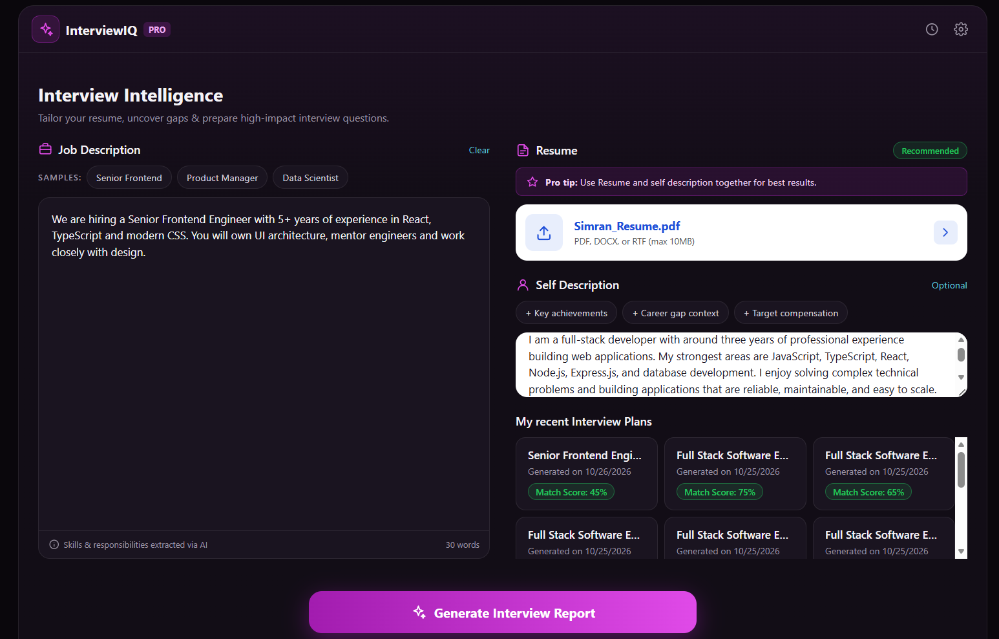
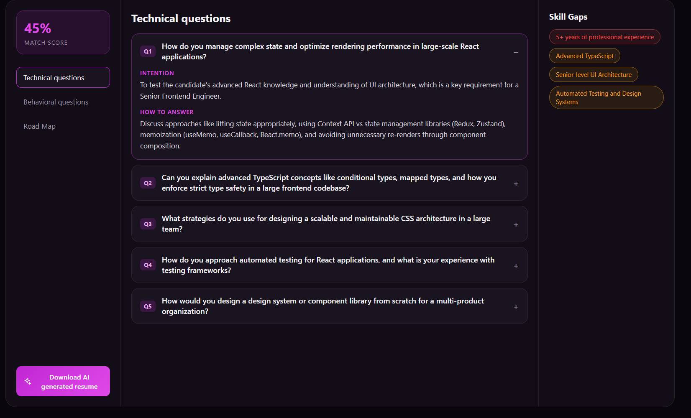

# InterviewIQ

**AI-Powered Interview Preparation and Resume Tailoring Platform**

InterviewIQ is a full-stack web application that helps candidates prepare for job interviews. Given a resume, a self-description and a target job description, it generates a personalized interview report containing a profile match score, likely technical and behavioral questions with guidance on how to answer them, an analysis of skill gaps, and a day-wise preparation plan. It can also produce an ATS-friendly resume tailored to the specific role.

**Technologies:** React 19, Vite, Node.js, Express 5, MongoDB, Google Gemini, JWT

---

## Screenshots

<p align="center">
  
  <br/><em>Home page: job description input, resume upload, self description and previously generated interview plans</em>
</p>

<p align="center">
  
  <br/><em>Interview report: match score, expandable questions with interviewer intention and suggested answers, and skill gaps by severity</em>
</p>

## Overview

Candidates preparing for an interview typically face two questions: what they are likely to be asked, and whether their resume suits the role. Answering these usually involves searching through generic question lists and manually rewriting the resume for each application.

InterviewIQ addresses both in a single workflow. The application extracts text from the uploaded resume (PDF), combines it with the self-description and the job description, and sends it to Google Gemini with a strict JSON schema defined using Zod. The structured response is stored in MongoDB against the user's account and presented in a dashboard. On request, the application generates a tailored resume and returns it as a PDF.

Key characteristics:

- **Role-specific output.** Questions, skill gaps and preparation tasks are derived from the candidate's own resume and the given job description rather than generic lists.
- **Explanatory guidance.** Each question includes the interviewer's intention, helping the candidate understand what is being assessed.
- **Reliable AI responses.** Schema-constrained generation ensures the frontend always receives well-formed, predictable data.
- **End-to-end workflow.** Analysis, preparation and resume tailoring are available in one place.

## Features

- **Authentication:** user registration and login with bcrypt password hashing, JWT stored in HTTP-only cookies, and token blacklisting on logout.
- **Resume parsing:** PDF upload (up to 3 MB) with server-side text extraction using `pdf-parse`.
- **Match score:** a score from 0 to 100 indicating how closely the candidate's profile fits the job description.
- **Technical questions:** role-specific questions, each with the interviewer's intention and a suggested approach to answering.
- **Behavioral questions:** questions with intention and structured (STAR-based) answer guidance.
- **Skill gap analysis:** missing or weak skills classified by severity (low, medium, high).
- **Preparation plan:** a day-wise schedule with focus areas and tasks.
- **Tailored resume generation:** the resume is rewritten for the target role and exported as an A4 PDF using Puppeteer.
- **Report history:** all generated reports are saved to the user's account for later reference.

## Tech Stack

| Layer | Technologies |
|---|---|
| Frontend | React 19, Vite, React Router, Context API with custom hooks, Axios, SCSS |
| Backend | Node.js, Express 5, Multer, pdf-parse, Puppeteer |
| AI | Google Gemini (`@google/genai`) with structured JSON output via Zod schemas |
| Database | MongoDB with Mongoose |
| Authentication and Security | JWT, bcryptjs, HTTP-only cookies, token blacklist, CORS |

## Architecture

```
+------------------+   Axios (cookies)   +-----------------------+
|  React + Vite    | ------------------> |  Express REST API     |
|  (Frontend)      | <------------------ |  (Backend)            |
+------------------+     JSON / PDF      +-----------+-----------+
                                                     |
                     +-------------------------------+---------------------------+
                     |                               |                           |
             +----------------+           +--------------------+      +------------------+
             |    MongoDB     |           |   Google Gemini    |      |    Puppeteer     |
             | users, reports |           | (Zod JSON schema)  |      |   HTML to PDF    |
             +----------------+           +--------------------+      +------------------+
```

**Report generation flow:** resume PDF, text extraction, prompt with Zod JSON schema, Gemini, validated JSON, storage in MongoDB, display in the dashboard.

## Project Structure

```
InterviewIQ/
├── docs/screenshots/              # Images used in this README
├── Backend/
│   ├── server.js                  # Entry point
│   └── src/
│       ├── app.js                 # Express app, middleware and routes
│       ├── config/database.js     # MongoDB connection
│       ├── controllers/           # Authentication and interview logic
│       ├── middlewares/           # JWT authentication, file upload (Multer)
│       ├── models/                # User, InterviewReport, Blacklist
│       ├── routes/                # /api/auth, /api/interview
│       └── services/ai.service.js # Gemini prompts and PDF generation
└── Frontend/
    └── src/
        ├── app.routes.jsx         # Route definitions
        ├── features/
        │   ├── auth/              # Login, Register, protected routes, context
        │   └── interview/         # Home (input form), report page, context
        └── style/                 # SCSS styles
```

## API Endpoints

| Method | Endpoint | Access | Description |
|---|---|---|---|
| POST | `/api/auth/register` | Public | Register a new user |
| POST | `/api/auth/login` | Public | Log in and receive a JWT cookie |
| GET | `/api/auth/logout` | Public | Clear the cookie and blacklist the token |
| GET | `/api/auth/get-me` | Private | Retrieve the logged-in user |
| POST | `/api/interview/` | Private | Generate a report (`multipart/form-data`: `resume`, `jobDescription`, `selfDescription`) |
| GET | `/api/interview/` | Private | List all reports of the user |
| GET | `/api/interview/report/:interviewId` | Private | Retrieve a single report |
| GET / POST | `/api/interview/resume/pdf/:interviewReportId` | Private | Download the tailored resume as a PDF |

## Getting Started

### Prerequisites

- Node.js 18 or later
- A MongoDB database (local or [MongoDB Atlas](https://www.mongodb.com/atlas))
- A Google Gemini API key ([Google AI Studio](https://aistudio.google.com/))

### 1. Clone the repository

```bash
git clone https://github.com/Simran-3012-ux/InterviewIQ.git
cd InterviewIQ
```

### 2. Set up the backend

```bash
cd Backend
npm install
cp .env.example .env    # then fill in the values
npm run dev             # runs on http://localhost:3000
```

Environment variables (`Backend/.env`):

| Variable | Description |
|---|---|
| `MONGO_URI` | MongoDB connection string |
| `JWT_SECRET` | Secret used to sign JWTs |
| `GEMINI_API_KEY` | Google Gemini API key |

### 3. Set up the frontend

```bash
cd ../Frontend
npm install
npm run dev             # runs on http://localhost:5173
```

Open http://localhost:5173, create an account and generate an interview report.

## Security

- Passwords are hashed with bcrypt and never stored in plain text.
- JWTs are stored in HTTP-only cookies, with an `Authorization: Bearer` header supported for API clients.
- Tokens are blacklisted in MongoDB on logout to prevent reuse.
- Reports are always queried by owner, so users can access only their own data.
- File uploads are limited to 3 MB, and secrets are kept in a git-ignored `.env` file.

## Future Enhancements

- Mock interview mode with voice input and AI feedback
- Shareable report links and PDF export of the complete report
- Cloud deployment (Vercel and Render) with environment-based API URLs
- Unit and integration tests

## Author

**Simran Maurya**
